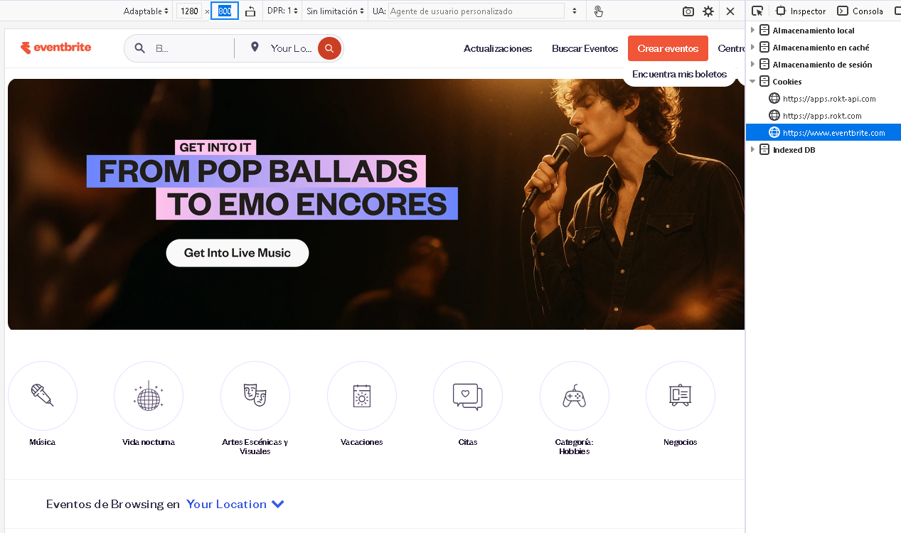
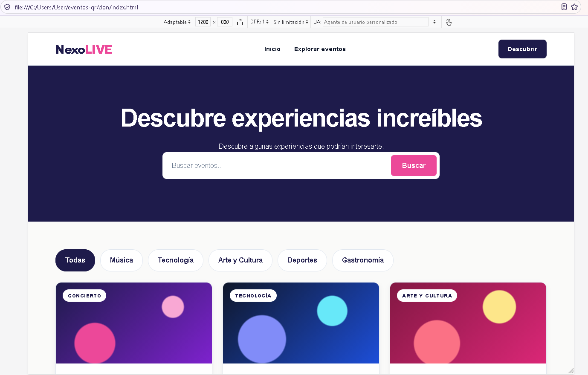
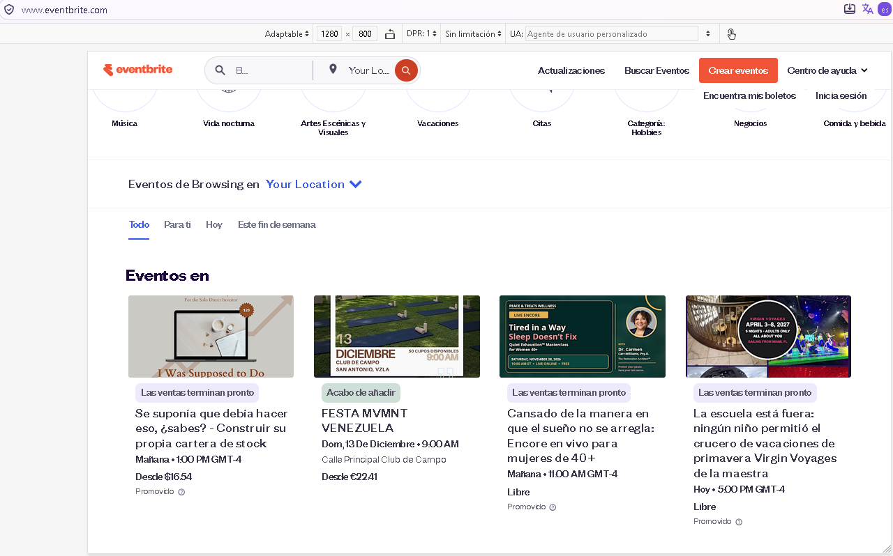
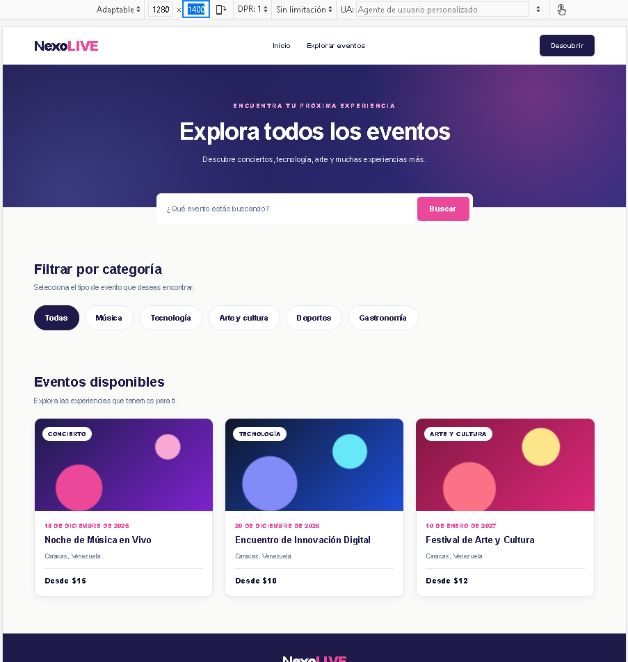
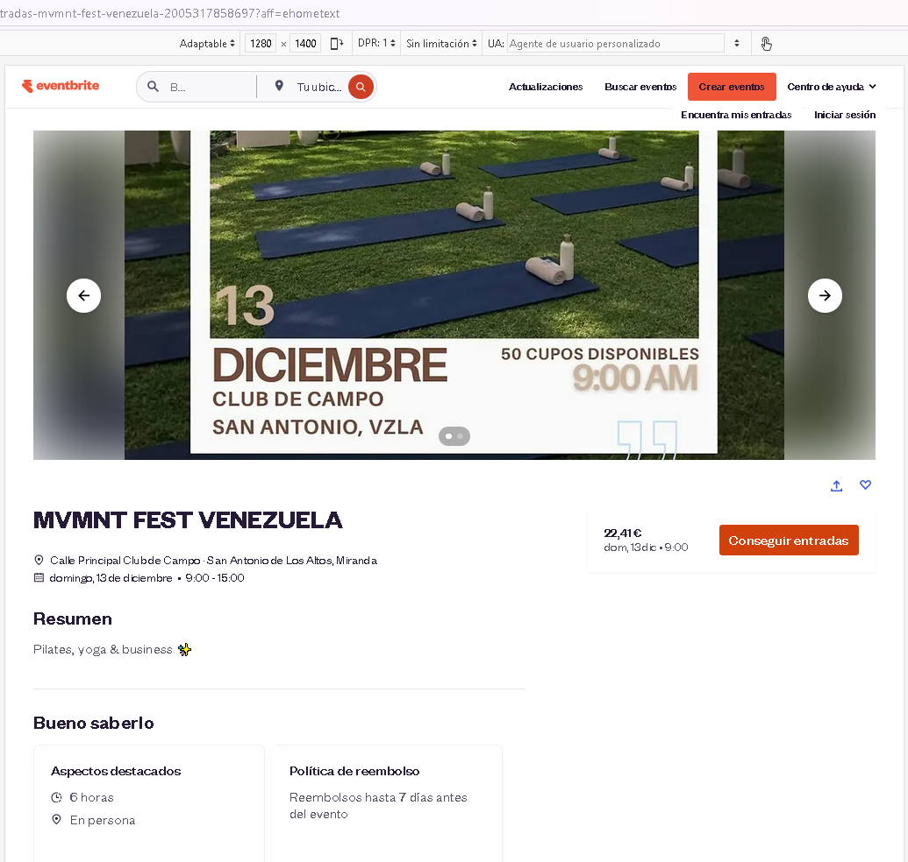
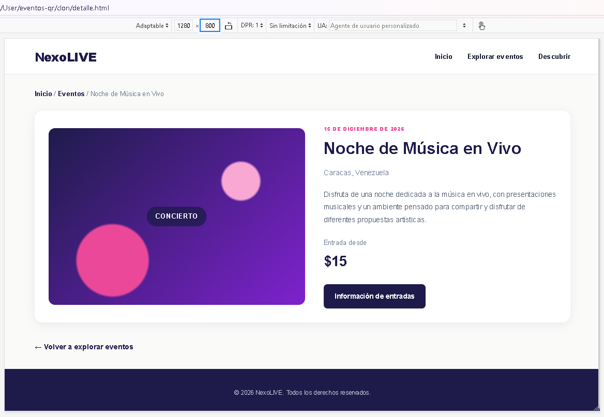

# NexoLIVE — Recreación de una plataforma de eventos

## 1. Descripción del proyecto

NexoLIVE es una recreación académica de una plataforma web para descubrir y consultar eventos. Este proyecto forma parte del Sprint 1 de la asignatura Lenguaje de Programación.

Se tomó como referencia el sitio web Eventbrite para estudiar su estructura, organización, navegación y experiencia de usuario. A partir de ese análisis se desarrolló una propuesta propia, con identidad visual, nombre y diseño diferentes.

El objetivo es comprender cómo se organiza una plataforma de eventos y aplicar los conocimientos de HTML, CSS y JavaScript mediante la construcción de tres pantallas funcionales.

**Sitio de referencia:** https://www.eventbrite.com

## 2. Identidad visual

La recreación utiliza la marca NexoLIVE y una paleta de colores propia:

| Elemento        | Color                | Código    |
| --------------- | -------------------- | --------- |
| Color principal | Azul oscuro          | `#1E1B4B` |
| Color de acento | Rosa                 | `#EC4899` |
| Fondo           | Blanco cálido        | `#FAFAF9` |
| Texto           | Azul grisáceo oscuro | `#0F172A` |

El diseño busca ofrecer una interfaz clara, organizada y adaptable a diferentes tamaños de pantalla.

## 3. Tecnologías utilizadas

- **HTML5:** estructura y contenido de las páginas.
- **CSS3:** diseño visual, colores, distribución y adaptación a dispositivos.
- **JavaScript:** búsqueda, filtros por categoría y comportamiento de la interfaz.
- **Visual Studio Code:** entorno de desarrollo.
- **Live Server:** visualización local del proyecto durante su desarrollo.

No se utilizaron frameworks ni bibliotecas de desarrollo para construir estas pantallas.

## 4. Estructura del proyecto

```text
clon/
├── capturas/
│   ├── 01-inicio-eventbrite.png
│   ├── 02-inicio-nexolive.png
│   ├── 03-listado-eventbrite.png
│   ├── 04-listado-nexolive.png
│   ├── 05-detalle-eventbrite.png
│   └── 06-detalle-nexolive.png
│
├── index.html
├── eventos.html
├── detalle.html
├── styles.css
├── main.js
└── README.md
```

### Descripción de los archivos

- `index.html`: pantalla principal de NexoLIVE.
- `eventos.html`: listado de eventos con búsqueda y filtros.
- `detalle.html`: información detallada de un evento.
- `styles.css`: estilos generales y diseño adaptable de las tres páginas.
- `main.js`: funcionalidad de búsqueda y filtros.
- `capturas/`: evidencias visuales de la comparación con Eventbrite.

## 5. Pantallas desarrolladas

### 5.1. Inicio

Es la página principal de NexoLIVE. Contiene el encabezado de navegación, un buscador, categorías y una selección de eventos destacados.

### 5.2. Listado de eventos

Presenta las tarjetas de los eventos disponibles, junto con opciones para buscar por texto y filtrar por categoría. Cuando no existen coincidencias, se muestra un mensaje informativo.

### 5.3. Detalle del evento

Muestra la información de un evento seleccionado, incluyendo su título, fecha, ubicación, descripción, precio y un botón informativo.

## 6. Comparación visual con Eventbrite

Se presentan las capturas del sitio de referencia y de la recreación propia para observar las diferencias y similitudes en la organización y presentación de las tres pantallas.

### 6.1. Pantalla de Inicio

| Eventbrite — Referencia                                                               | NexoLIVE — Recreación                                                             |
| ------------------------------------------------------------------------------------- | --------------------------------------------------------------------------------- |
|  |  |

### 6.2. Listado de eventos

| Eventbrite — Referencia                                                                 | NexoLIVE — Recreación                                                               |
| --------------------------------------------------------------------------------------- | ----------------------------------------------------------------------------------- |
|  |  |

### 6.3. Detalle del evento

| Eventbrite — Referencia                                                                 | NexoLIVE — Recreación                                                               |
| --------------------------------------------------------------------------------------- | ----------------------------------------------------------------------------------- |
|  |  |

**Nota sobre las capturas:** todas se realizaron con un ancho de 1280 píxeles. Las capturas de Detalle tienen alturas de 1400 píxeles para Eventbrite y 800 píxeles para NexoLIVE, debido a las diferencias en la extensión del contenido visible.

## 7. Diseño adaptable

Las tres pantallas fueron probadas en diferentes tamaños de pantalla:

| Dispositivo |   Ancho | Resultado              |
| ----------- | ------: | ---------------------- |
| Teléfono    |  375 px | Visualización correcta |
| Computador  | 1280 px | Visualización correcta |

También se realizaron pruebas en Firefox y Chrome para comprobar la presentación y navegación de las páginas.

## 8. Cómo ejecutar el proyecto

1. Abrir la carpeta `clon` en Visual Studio Code.
2. Comprobar que esté instalada la extensión Live Server.
3. Abrir el archivo `index.html`.
4. Hacer clic derecho y seleccionar **Open with Live Server**.
5. Utilizar el menú de navegación para acceder a las demás pantallas.

## 9. Alcance académico

Esta recreación corresponde al ejercicio de ingeniería inversa del Sprint 1, dentro de la metodología «Recrea → Reinventa».

NexoLIVE utiliza una identidad visual propia y una implementación desarrollada desde cero. No constituye todavía el producto completo de Eventos QR.

A partir del Sprint 2, el desarrollo del producto continuará en la carpeta `src/`, utilizando TypeScript según las indicaciones del proyecto.
