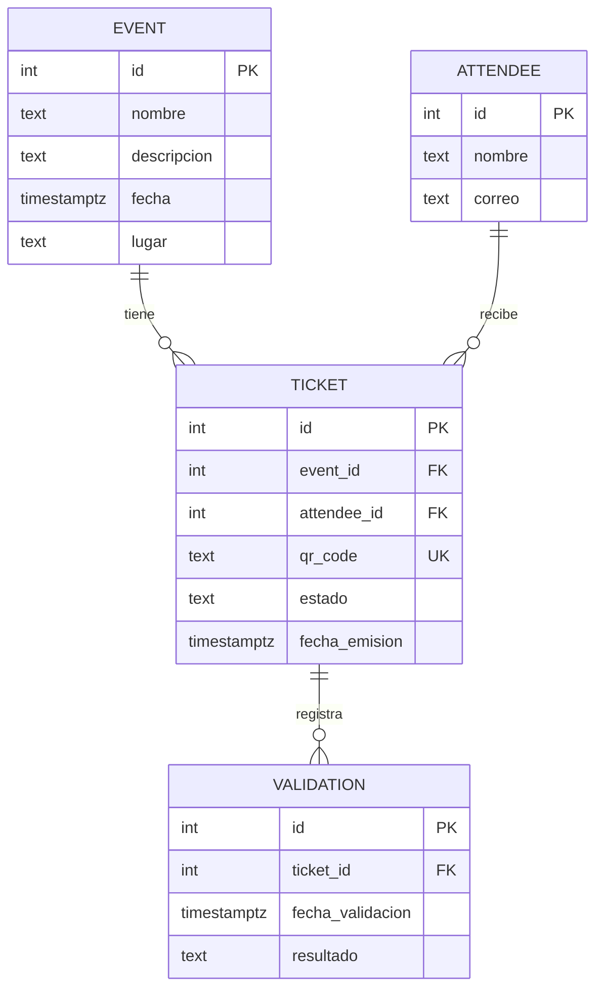

# PRD · Eventos QR

> Documento de requisitos del producto (Product Requirements Document).
> Complétalo en el Sprint 0 (historia H0.3) y pide la aprobación del profesor en un Issue.
> Cada requisito funcional (RF) se convierte en un Issue con la plantilla "Historia de usuario".

| Campo               | Valor                        |
| ------------------- | ---------------------------- |
| Alumno              | Julio Amundaray              |
| Proyecto n.º        | 22                           |
| Sitio de referencia | Eventbrite                   |
| Compañero revisor   | ferdiaz0905-code             |
| URL desplegada      | (se completa en el Sprint 5) |

## 1. Problema

Los organizadores de eventos necesitan verificar las entradas y controlar el acceso de los asistentes.
La revisión manual puede generar retrasos, errores y permitir el uso de entradas duplicadas.
Eventos QR facilita este proceso mediante entradas digitales con códigos QR únicos y verificables.

## 2. Usuarios

- **Usuario principal:** Organizador de eventos que necesita registrar asistentes, generar entradas digitales y validar su autenticidad desde un dispositivo móvil.
- **Usuario secundario:** Asistente al evento que recibe su entrada con código QR y la presenta al momento de ingresar.

## 3. Objetivo y métrica de éxito

Permitir que los organizadores validen las entradas mediante códigos QR en menos de 5 segundos por asistente, identificando las entradas válidas y evitando que un mismo código sea utilizado más de una vez.

## 4. Alcance del MVP

1. Registrar y administrar eventos.
2. Registrar los datos de los asistentes.
3. Generar entradas digitales con códigos QR únicos.
4. Consultar y visualizar las entradas emitidas.
5. Validar los códigos QR mediante la cámara de un dispositivo.
6. Evitar que una misma entrada sea utilizada más de una vez.

### Funcionalidades → carpetas de `src/` (screaming architecture)

Cada funcionalidad del alcance será una carpeta en `src/`. Nómbralas en inglés y en plural.

| Funcionalidad                  | Carpeta             |
| ------------------------------ | ------------------- |
| Administración de eventos      | src/events          |
| Registro de asistentes         | src/attendees       |
| Generación de entradas QR      | src/tickets         |
| Consulta de entradas           | src/ticket-lists    |
| Validación de códigos QR       | src/validations     |
| Control de entradas duplicadas | src/access-controls |

## 5. Fuera de alcance

- Procesamiento de pagos en línea.
- Venta de entradas mediante plataformas externas.
- Envío automático de entradas por SMS.
- Aplicación móvil independiente para Android o iOS.
- Integración con sistemas externos de control de acceso.

## 6. Requisitos funcionales

| ID    | Requisito                                                                    | Prioridad (alta, media, baja) |
| ----- | ---------------------------------------------------------------------------- | ----------------------------- |
| RF-01 | El sistema debe permitir registrar y administrar eventos.                    | alta                          |
| RF-02 | El sistema debe permitir registrar los datos de los asistentes.              | alta                          |
| RF-03 | El sistema debe generar entradas digitales con códigos QR únicos.            | alta                          |
| RF-04 | El sistema debe permitir consultar las entradas emitidas.                    | media                         |
| RF-05 | El sistema debe validar los códigos QR mediante la cámara de un dispositivo. | alta                          |
| RF-06 | El sistema debe impedir que una entrada validada vuelva a utilizarse.        | alta                          |

## 7. Requisitos no funcionales

- Responsive, móvil primero (375 px y 1280 px).
- Lighthouse ≥ 90 en Accesibilidad y Buenas prácticas.
- 0 errores en la consola del navegador.
- Funciona con 10.000 registros sin congelarse.

## 8. Modelo de datos

Diagrama entidad-relación y tablas PostgreSQL con tipos, claves y restricciones.
GitHub dibuja diagramas Mermaid; edita este ejemplo:

## 9. Reto técnico distintivo

El reto técnico consiste en generar códigos QR únicos para cada entrada y validarlos mediante la cámara de un dispositivo. Se resolverá utilizando una biblioteca para generar los códigos QR y otra herramienta para leerlos y comprobar su autenticidad. El sistema también verificará que cada entrada no haya sido utilizada anteriormente.

## 10. Riesgos y preguntas abiertas

- Fallas en la cámara o dificultades para leer los códigos QR.
- Problemas de conexión a Internet durante la validación de entradas.
- Riesgo de que una entrada sea compartida o utilizada por otra persona.
- Definir cómo se manejará la validación cuando no haya conexión a Internet.
- Determinar qué medidas de seguridad protegerán los datos de los asistentes.
